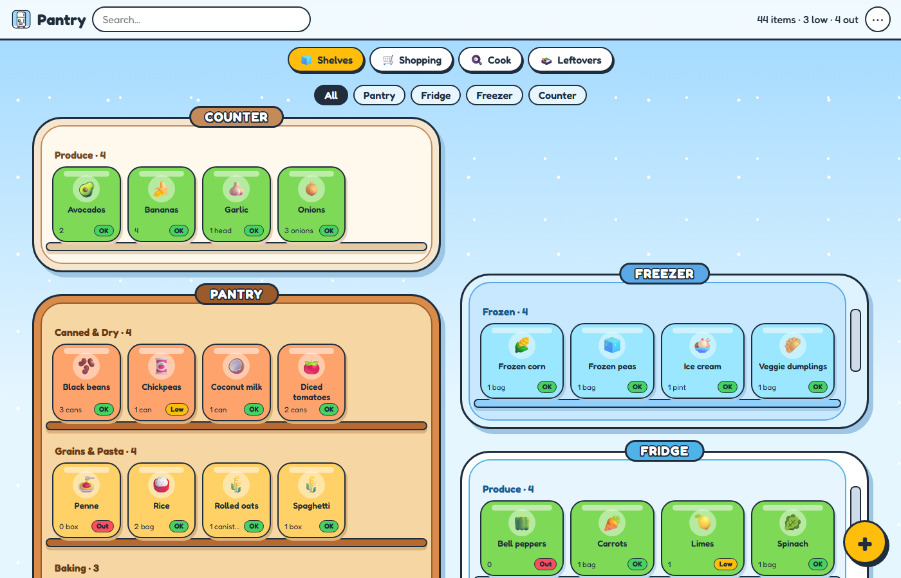
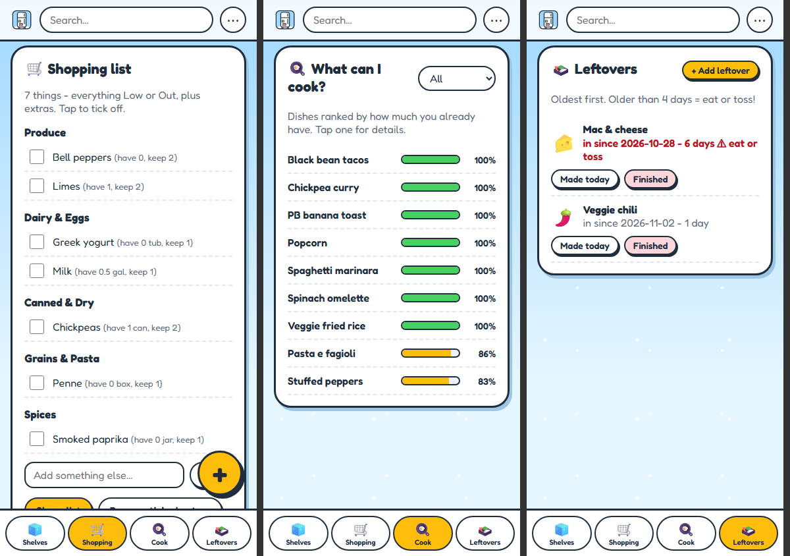
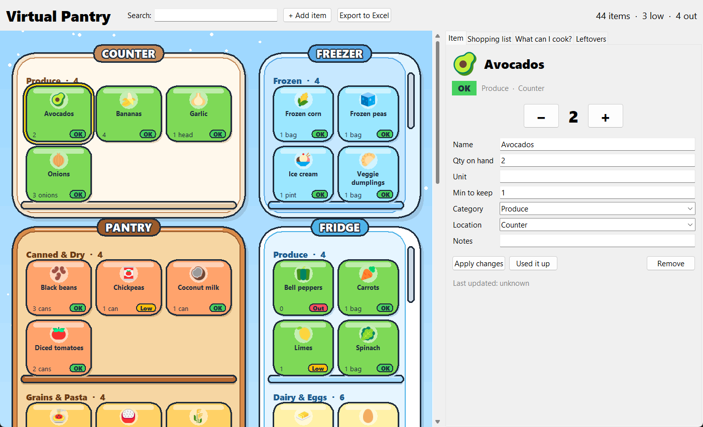

# 🧊 Virtual Pantry

A cartoon-style pantry tracker that shows your **pantry, fridge and freezer as illustrated shelves**, with every food item as an emoji tile. Tap an item to change how much you have, see what's running low, build a shopping list, find out **what you can cook** with what's in stock, and keep track of how old your leftovers are.

It started as a Python desktop app and grew into a mobile-friendly web app that syncs between phone and laptop.

**Live web app:** [syncsalerno.com/pantry](https://syncsalerno.com/pantry/). Try it with no account ("Use on this device only"). It starts empty; tap the **+** to add things.

| Web app (laptop) | Web app (phone) |
|---|---|
|  |  |

**Desktop app (Python + tkinter):**



*Screenshots use the made-up sample data in this repo.*

## Features

- **Illustrated shelves:** pantry cabinet, counter, freezer and fridge, drawn with thick outlines, rounded "bubbly" shapes and a snowy background. One shelf per category, and each tile shows a color-matched emoji, the quantity and an **OK / Low / Out** badge.
- **Quick edits:** − / + buttons, double-click to use one up, edit any field, "Used it up", and remove (with confirmation).
- **Search:** fades every tile that doesn't match.
- **Shopping list:** everything Low or Out, grouped by category, with tick-off boxes, your own extras, and copy/share.
- **What can I cook?:** ranks your saved dishes by the share of their ingredients you have in stock, lists what's missing, and adds missing items to the shopping list in one tap. Matching handles plurals, alternatives ("feta *or* mozzarella"), synonyms ("scallion" = "green onion") and ignores staples such as salt and oil.
- **Leftovers:** shows the oldest first, with how many days each has been in the fridge, and flags anything over 4 days as "eat or toss".
- **Excel round trip (desktop):** a one-time import from an existing spreadsheet, and an "Export to Excel" that rewrites only the inventory rows. It keeps formulas, conditional formatting and the other sheets, and makes a backup first.
- **Sync (web):** optional Firebase sign-in syncs live between devices and works offline. Without an account, data stays in the browser.
- **Installable:** add it to an iPhone home screen and it opens full-screen with a cartoon fridge icon.

## Tech

| | Desktop | Web |
|---|---|---|
| Language | Python 3 | JavaScript (ES modules, no build step) |
| UI | tkinter `Canvas` (all shapes hand-drawn), ttk | HTML + CSS |
| Data | SQLite (`sqlite3`) | Firebase Firestore (live sync, offline cache) or `localStorage` |
| Other | openpyxl (Excel import/export), Pillow (color emoji rendering) | Firebase Auth, Web App Manifest |

A few problems I solved along the way:
- **No rounded shapes in tkinter:** tkinter has no rounded rectangle, so every shape is a polygon traced along quarter-circle corners.
- **Black-and-white emoji:** tkinter draws emoji in black and white on Windows, so Pillow renders them in color and hands tkinter images instead.
- **Sharp on high-DPI screens:** the desktop app is DPI-aware, and its tile sizes come from real font metrics.
- **Safe Excel export:** it resizes the sheet's Excel table and conditional-formatting ranges instead of rebuilding the workbook.
- **Sign-in on iPhone:** web sign-in uses email and password, because Google's pop-up sign-in fails inside iOS home-screen apps.

## Run the desktop app

```bash
cd desktop
pip install -r requirements.txt     # openpyxl, Pillow (both included with Anaconda)
python make_sample_data.py          # creates a sample spreadsheet with made-up items
python import_excel.py              # loads it into pantry.db
python pantry_app.py                # opens the app
```

## Run the web app

The `web/` folder is a plain static site. Serve it with any static file server:

```bash
cd web
python -m http.server 8000          # then open http://localhost:8000
```

To sync between devices, create a Firebase project and paste its web config into `web/firebase-config.js`. Without that, the app runs in this-device-only mode. To move data over from the desktop app, run `python desktop/export_for_web.py`, then use **⋯ → Import from desktop app** in the web app.

## Project layout

```
desktop/   Python app: pantry_app.py (UI), db.py (SQLite), import_excel.py / export_excel.py,
           cook_match.py (recipe matching), emoji_icons.py, make_icon.py, make_sample_data.py
web/       Web app: index.html, style.css, app.js (UI), logic.js (rules), data.js (storage/sync)
docs/      Screenshots
```

---

Built by John Salerno with Claude Code.
